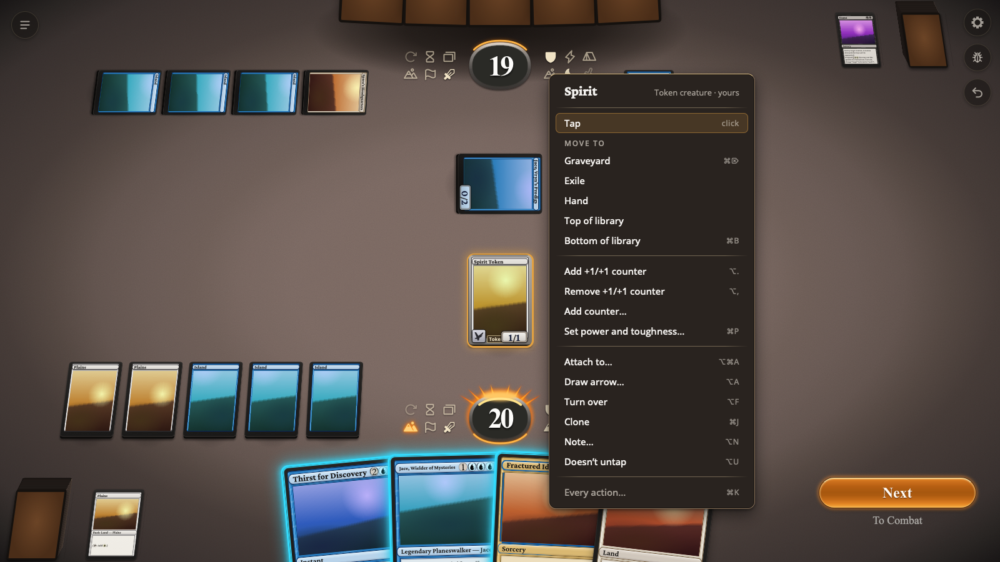
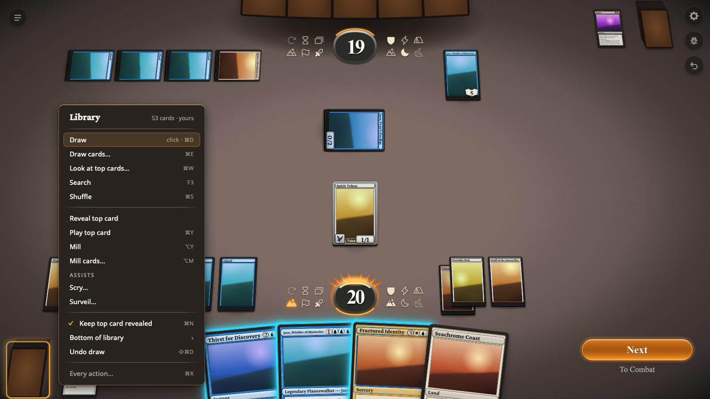
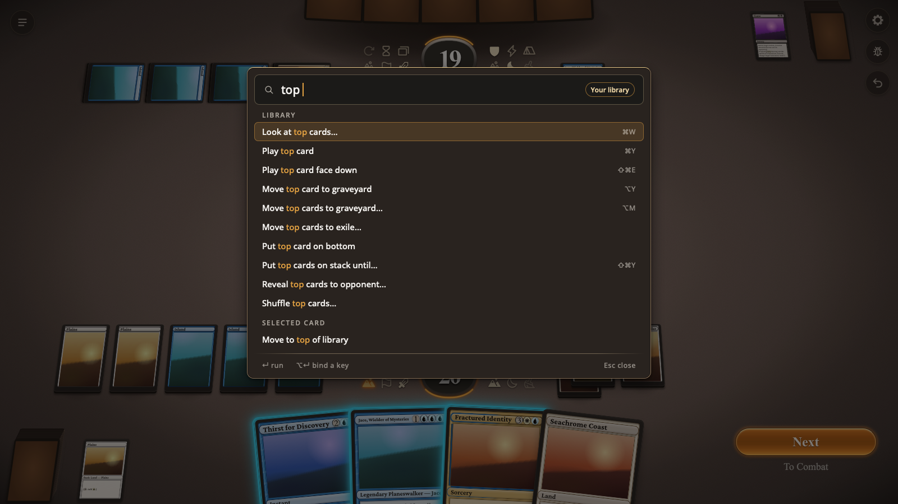
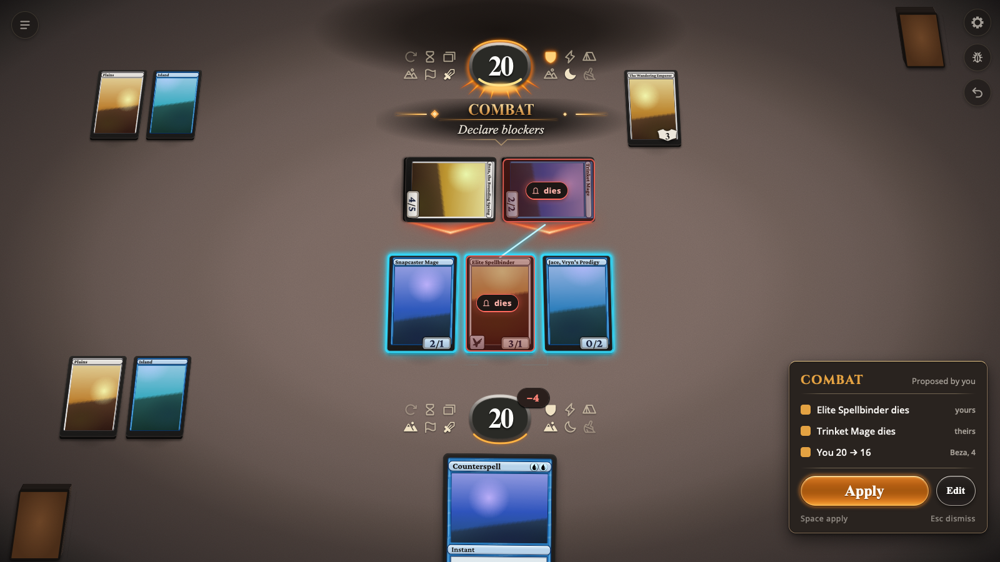
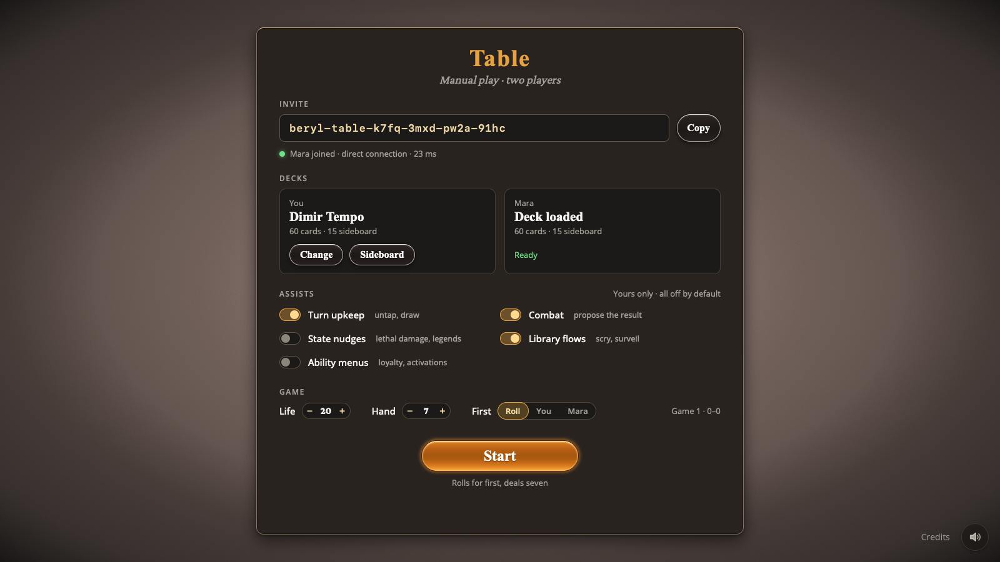

# Manual multiplayer

*A design for a mode in which two people play Magic against each other in Beryl
with no rules enforcement, moving the cards themselves as they would in
Cockatrice. Decided 2026-11-12 in a design interview, on a survey of Beryl's
code, a survey of Cockatrice's source at commit `587c4b43c`, and measurements
taken that day.*

Beryl is a desktop app that plays Magic: The Gathering. Today it plays one kind
of game: one person against an AI, with every move checked by Beryl's rules
engine. This document calls that an **engine game**. The rules engine knows 47
cards, so no tournament deck is fully playable, and two people cannot play each
other at all.

Cockatrice is an open-source app for playing Magic online. It solves the same
problem by enforcing nothing: it is a shared table where each player moves, taps
and counts by hand, and the players apply the rules themselves. Any card works.
Its interface is a free grid of cards under menus three levels deep.

This document specifies a **manual table** for Beryl: a game where the app keeps
the cards, zones, counters and life totals, and applies no rules. It has four
parts.

- **Everything Cockatrice lets a player do to a game**, drawn on Beryl's table
  with Beryl's animation, and reachable by direct manipulation, a plain context
  menu, a searchable list of commands and Cockatrice's keyboard shortcuts.
- **Assists**, which go beyond Cockatrice. An **assist** is an optional helper
  that works out a group of ordinary manual actions, such as the result of
  combat, and applies them only when a player clicks. Every assist is off until
  a player turns it on. See the [Assists](#assists) section below.
- **Peer-to-peer play** between two copies of the app, with no service run by
  the project.
- **A connection the rules engine can use later**, so that two people can
  eventually play an engine game against each other.

The interface matters most. Where this document chooses between an easier build
and a better table, it chooses the table.

A few parts of Beryl are named throughout, and are defined here once.

- **The stage** is the part of Beryl's interface that draws the table and
  animates it.
- **The session** is the part of Beryl, written in Rust, that runs a game and
  tells the interface what to show.
- **A view** is everything one player may see at one moment. **A script** is the
  list of animation steps that turns the previous view into the next. The
  session sends the stage a view and a script for each change. See the
  [Views and animation](#views-and-animation) section below.
- **The card store** is a data file built into the app with a record for every
  card: name, type line, mana cost, rules text, power and toughness, keywords
  and image addresses.

## Related information

- [Cockatrice inventory](manual-multiplayer-cockatrice.md): the appendix to this
  document. Every Cockatrice control that manipulates a game, with the gesture,
  menu row and key that reaches it in Beryl. Read it beside the
  [Interaction](#interaction) section.
- [Engine architecture](engine-architecture.md), decisions K22 to K26: the view
  and script contract between the session and the stage, which the manual table
  reuses unchanged.
- [Engine architecture](engine-architecture.md), sections 13 and 19.2: hidden
  information and the session's protocol for engine games.
- [UI Conventions](ui-conventions.md): Beryl's design language. Beryl's
  interface follows MTG Arena's except where that page lists an exception. Arena
  has no manual mode, so the manual table adds entries to that page's "Not seen
  in Arena" list.
- [Cockatrice](https://github.com/Cockatrice/Cockatrice): the reference for the
  action set and the shortcuts.
- [iroh](https://docs.iroh.computer/) and its
  [relay documentation](https://docs.iroh.computer/concepts/relays): the
  peer-to-peer library this design uses, and the terms of the public relay
  servers it falls back to.
- Reference images in `docs/ui_mockups/`, shown in the sections they illustrate:
  `manual_card_menu.png`, `manual_library_menu.png`, `manual_palette.png`,
  `manual_combat_proposal.png` and `manual_lobby.png`. Each is a real screenshot
  of an engine game with the proposed interface drawn over it. They show intent,
  and are not a specification of sizes or positions.

## Decisions

The interview settled the decisions below. T19 to T24 were not asked: they are
defaults chosen while writing, recorded here so they can be challenged.

Who it is for, and what a table is:

| ID  | Decision                                                                                                                                                               | Why                                                                                                              |
| --- | ---------------------------------------------------------------------------------------------------------------------------------------------------------------------- | ---------------------------------------------------------------------------------------------------------------- |
| T1  | The audience is friends, joined by an invite code. There is no public list of games, no accounts and no matchmaking. A modified app could cheat, and that is accepted. | Play with strangers needs a hosted service and cryptographic shuffles. Neither is wanted.                        |
| T2  | A table seats two players. The table state, its actions, the log and the handshake number seats and never say "opponent".                                              | Beryl's stage is a two-seat layout. Numbered seats cost nothing now and leave less to change for a larger table. |
| T13 | There is no text chat and no "OK" or "your turn" signal. Players are assumed to be on a voice call.                                                                    | Decided in the interview.                                                                                        |
| T14 | A player may act on any card in a public zone and on either life total. A hand or library is its owner's unless revealed or lent.                                      | Removal and discard take one action instead of asking the other player to move their card.                       |
| T15 | Setup and match flow are guided, and every step can be skipped or redone by hand. Nothing is enforced.                                                                 | Cockatrice leaves the first two minutes of each game as chores.                                                  |
| T18 | A deck may hold any card in the card store. Nothing checks deck size or legality.                                                                                      | The store has 34,205 cards and needs no rules engine to draw one.                                                |
| T21 | A solo table, with one seat and no connection, is the same table.                                                                                                      | It needs nothing extra and is the first thing that can be played and tested.                                     |
| T23 | Spectators are not supported.                                                                                                                                          | Numbered seats leave room for them.                                                                              |

How it is built:

| ID  | Decision                                                                                                                                               | Why                                                                                                                                        |
| --- | ------------------------------------------------------------------------------------------------------------------------------------------------------ | ------------------------------------------------------------------------------------------------------------------------------------------ |
| T3  | One player's app, the host, holds the table. It sends each seat its view and script, and the other app, the guest, sends actions.                      | The session already builds a view and a script per seat. The guest only displays, and the rules engine can sit behind the same connection. |
| T4  | Two apps connect with iroh, behind a small interface that also has an in-memory and a localhost implementation.                                        | One pasted code connects two machines behind home routers. Tests and two apps on one Mac never need the internet.                          |
| T5  | The manual table has its own state, separate from the rules engine's.                                                                                  | The engine's state has closed lists of counters and zones, cannot be saved to a file, and knows only its 47 cards.                         |
| T7  | The parts that need no change to the stage or the session are independent of the rebuilding of both that is in progress. The rest waits for the stage. | The session and the stage took about 170 commits in three days. The table should not add to that churn or be broken by it.                 |
| T19 | Both apps must be the same build. The handshake refuses a mismatch.                                                                                    | The connection carries Beryl's own view types, which change daily.                                                                         |
| T20 | The host saves the table after every action. A guest who drops rejoins with the same invite code.                                                      | The host has the only copy of the game.                                                                                                    |
| T22 | The connection carries whole views and scripts, not table actions for the guest to replay.                                                             | It is the only shape the rules engine can also produce. A view and script from an engine game is 1.3 KB compressed.                        |

How it is used:

| ID  | Decision                                                                                                                                                                        | Why                                                                                                                                                                           |
| --- | ------------------------------------------------------------------------------------------------------------------------------------------------------------------------------- | ----------------------------------------------------------------------------------------------------------------------------------------------------------------------------- |
| T6  | Permanents sit in Beryl's automatic rows. Dragging reorders within a row or pins a card to another row.                                                                         | Automatic rows keep the stage's layout and its layout checks. Free placement is where Cockatrice tables get messy.                                                            |
| T8  | Assists are off by default. An assist proposes a group of ordinary actions, and one click from a player applies all of it, to both players' cards.                              | One click must be enough. Every change is logged and can be undone by either player.                                                                                          |
| T9  | There are five assists: turn upkeep, combat, state nudges, library flows and ability menus. Trigger reminders and mana suggestions are not included.                            | These five read fixed forms: keywords, type lines, numbers, and the cost-colon-effect shape of an ability. Reminders and mana would have to understand what rules text means. |
| T10 | The context menu is a list of plain labeled rows and nothing else. It holds no icon buttons, steppers or other controls. A row that needs a number opens a prompt.              | Two richer menus were drawn and rejected: a row of icon buttons, then inline steppers. A context menu should be a list of commands.                                           |
| T11 | A plain click acts. Cmd-click and a dragged rectangle select.                                                                                                                   | It matches engine games and is the only workable mapping on touch. A misclick costs one undo.                                                                                 |
| T12 | Anything can be undone, including shuffles, looks and die rolls. A key undoes the player's own last action, and any log line can rewind the whole table.                        | Takebacks among friends are a social matter. The log says what was undone and what was seen.                                                                                  |
| T16 | The desktop comes first. Every interaction is specified with a touch equivalent, and no command assumes a mouse or a keyboard.                                                  | Beryl's phone app is unfinished. Designing touch in now avoids revisiting the interaction model.                                                                              |
| T17 | Shortcuts are Cockatrice's defaults, with Cmd on macOS where Cockatrice says Ctrl. Where a default collides with macOS or Beryl, Cockatrice's wins if the app can take the key. | Muscle memory is the point of keeping them.                                                                                                                                   |
| T24 | Playing a card sends a land to the battlefield and anything else to the stack. This is what "play" means, not an assist.                                                        | It is Cockatrice's default, and a click has to send the card somewhere.                                                                                                       |

## The table

This section defines what the app stores for a manual game. The **table** is
that state: every card and where it is, each player's life and counters, the
turn, and the log of what was done.

The table is a new library. It does not depend on the rules engine or on any
card's rules implementation, and neither depends on it. It depends only on the
card store. It can be saved to a file, since it is saved after every action.

A card on the table is an object with the fields below. The example is a
creature with a counter and a note.

```rust
Object {
    id: 41,
    card: Card::Named("Tarmogoyf"),      // or Card::Custom { name, types, .. }
    owner: Seat(0), controller: Seat(0), // seats are numbered from 0
    zone: Zone::Battlefield,
    face: Face::Front,                   // Front, Back or Down
    tapped: true, token: false,
    counters: [("+1/+1", 1)],
    stats: Some((4, 5)),                 // shown as 5/6: stats, then counters
    damage: 0,
    note: Some("blocked this turn"),
    attached_to: None, doesnt_untap: false,
    row: Row::Auto, known_to: [Seat(0), Seat(1)],
}
```

The fields carry these rules.

- **`card`** is a name in the card store, or a custom token a player described.
  The table never interprets a name. Type line, printed power and toughness,
  keywords and rules text come from the store when something needs them.
- **`owner` and `controller`** differ when a player has taken control of the
  other's permanent.
- **`face`** is `Front`, `Back` for the second face of a two-faced card, or
  `Down`.
- **`counters`** maps a free-form name to a count from 0 to 999. The interface
  offers the common names (+1/+1, −1/−1, loyalty, charge, lore, stun) and
  accepts any text.
- **`stats`** holds a manual power and toughness that replaces the printed one.
  The card shows the manual value if set, otherwise the printed value, plus its
  +1/+1 counters and minus its −1/−1 counters. A printed `*` counts as zero
  until a manual value is set.
- **`damage`** is damage marked on a permanent this turn.
- **`row`** is `Auto`, or a row the player pinned the card to. See
  [Placement](#placement).
- **`known_to`** lists the seats that know which card this object is. See
  [Hidden information](#hidden-information).

Zones are each seat's library, hand, graveyard, exile and sideboard, plus one
battlefield and one stack. Every zone is ordered. The stack's newest entry is
its top. A stack entry is a card or an **ability marker**: a stand-in for an
activated or triggered ability, which names its source card and carries a line
of text.

The table also holds the following.

- **Each player's life total and counters.** Beryl's table already shows a mana
  pool of six symbols beside each life total. On a manual table each symbol is a
  counter the player sets by hand, and a player may add counters with any name:
  poison, energy, storm.
- **The turn:** whose it is, and the current phase. The phases are Cockatrice's
  eleven: untap, upkeep, draw, first main, beginning of combat, declare
  attackers, declare blockers, combat damage, end of combat, second main, end.
- **The arrows players have drawn,** each with the seat that drew it.
- **The match:** each player's deck and sideboard, the starting life and hand
  size, and the score.
- **The log.** See [The log, undo and rewind](#the-log-undo-and-rewind).

### Hidden information

Only the host's machine holds the whole table. Everything sent to a seat has had
what that seat should not know removed.

- **A seat sees a card's identity only if it is in that card's `known_to`.**
  Otherwise the object reaches that seat with no name, and the stage draws a
  card back.
- **A card in a public zone is known to every seat** unless it is face down. A
  face-down card keeps the `known_to` it had when it was turned down, plus any
  seat that peeks at it. It is drawn as a card back for everyone, and its
  preview shows its face only to the seats that know it.
- **A card entering a hand becomes known to that hand's owner only,** and is
  given a new id, so the other player cannot follow a card they once saw into a
  hand. Revealing a hand adds the seats it is revealed to.
- **Knowledge is removed in exactly two places:** a card entering a hand, and a
  shuffle. Nothing else ever removes a seat from `known_to`.
- **A card entering a library keeps its `known_to`.** A card I put on top of my
  library is still known to me, and to you if you had seen it. Its position is
  public.
- **A sideboard is known to its owner.**
- **A shuffle forgets.** It clears `known_to` for every card shuffled and gives
  those cards new ids.
- **Looking adds knowledge.** Looking at cards adds the looker to their
  `known_to`. Revealing adds the seats revealed to.
- **The host's random numbers decide shuffles, die rolls, coin flips and random
  reveals.** Each outcome is written to the host's log, so a replay or an undo
  never rolls again. A shuffle's outcome is never sent to a seat.

The redaction rule is exact and is tested as stated: nothing sent to a seat (a
view, a script, a log line or a proposal) may contain a card name for an object
whose `known_to` excludes that seat.

An example shows the rule. Seat 0 draws a card. The two seats receive the same
object with one difference.

```json
{ "to_seat": 0, "object": { "id": 77, "zone": "hand", "name": "Brainstorm" } }
{ "to_seat": 1, "object": { "id": 77, "zone": "hand", "name": null } }
```

### Placement

Permanents are placed by Beryl's existing layout, not by the player. Each side
of the battlefield has a creature row, a row for other permanents and a group of
lands. A permanent's row comes from its type line in the store.

- **Dropping a permanent between two cards of its row reorders it.** The order
  is part of the table and is the same for both players.
- **Dropping a permanent in another row on its controller's side pins it
  there,** by setting `row`. An animated land goes to the creature row this way.
  The pin lasts until the card leaves the battlefield.
- **Dropping a permanent on the other player's side gives them control of it.**
- **Dropping an Aura, Equipment or Fortification on a permanent attaches it.**
  Any other card can be attached through its menu. An attached card sits tucked
  under its host and moves with it. Dragging it off unattaches it.
- **A face-down card and a custom token with no type sit in the creature row.**

There are no free coordinates. A table can therefore never show overlapping or
off-screen cards, and the stage's layout checks apply unchanged.

### Actions

Every change to the table is an **action**: a small value, written as JSON,
naming what to do and to which objects. Gestures, menu rows, shortcuts, the
command list and assists all produce actions, and nothing else changes the
table.

Every action names its objects by id together with the zone the sender saw them
in. Two examples show the shape. The first moves two cards from a hand to a
graveyard. The second adds a counter.

```json
{ "move": { "objects": [12, 15], "in": { "hand": 0 },
            "to": { "graveyard": 0 }, "face": "front" } }
{ "counter": { "objects": [41], "in": "battlefield",
               "name": "+1/+1", "add": 1 } }
```

The complete set follows. Each takes one object or many, so acting on a
selection is one action and one log line.

| Action                                    | What it does, and what it takes                                                                                                 |
| ----------------------------------------- | ------------------------------------------------------------------------------------------------------------------------------- |
| `move`                                    | Moves cards to a zone: a position (top, bottom, or nth), a face, and tapped or not.                                             |
| `reorder`, `pin`, `give`                  | Changes a card's place in a row or a hand, pins it to a row, or gives control to a seat.                                        |
| `tap`, `face`, `flag`                     | Sets tapped; sets the face (front, back, down); sets "doesn't untap".                                                           |
| `peek`                                    | Adds the acting seat to a face-down card's `known_to`.                                                                          |
| `counter`, `stats`, `damage`, `note`      | Adds to or sets a named counter; sets or clears manual power and toughness, damage, a note.                                     |
| `attach`, `unattach`                      | Attaches cards to a host permanent, or detaches them.                                                                           |
| `clone`, `token`, `marker`                | Creates a copy of a card, a token (from the store or custom; optionally attached to a card), or an ability marker on the stack. |
| `remove`                                  | A token or marker ceases to exist.                                                                                              |
| `draw`, `mulligan`                        | Draws n cards; shuffles a hand into its library and draws n.                                                                    |
| `shuffle`                                 | Shuffles a whole library, or its top or bottom n cards.                                                                         |
| `look`                                    | Shows the acting seat the top or bottom n cards of a library, or all of it.                                                     |
| `reveal`                                  | Shows chosen cards, a whole zone, or n random cards of it, to named seats.                                                      |
| `lend`                                    | Lets another seat act on this hidden zone until it is next shuffled.                                                            |
| `always_reveal_top`, `always_look_at_top` | Keeps a library's top card revealed to all, or known to its owner.                                                              |
| `sort_hand`                               | Orders a hand by name, type or mana value.                                                                                      |
| `life`, `player_counter`                  | Adds to or sets a life total or a player's named counter.                                                                       |
| `phase`, `next_turn`                      | Sets the phase; passes the turn.                                                                                                |
| `roll`                                    | Rolls n dice of s sides, or flips coins.                                                                                        |
| `arrow`, `clear_arrows`                   | Draws an arrow from a card to a card or player; removes the acting seat's arrows.                                               |
| `load_deck`, `sideboard`, `ready`         | Sets a seat's deck; swaps cards between deck and sideboard; marks the seat ready.                                               |
| `start`, `next_game`, `concede`           | Starts a game; ends the game with a result and returns to the lobby; concedes.                                                  |
| `undo`, `rewind`                          | See [The log, undo and rewind](#the-log-undo-and-rewind).                                                                       |
| `batch`                                   | Applies several actions as one. See [Assists](#assists).                                                                        |

A few changes happen as a consequence of an action. All but the last two are
Cockatrice's.

- **Leaving the battlefield clears a card's state:** tapped, counters, manual
  stats, damage, the doesn't-untap flag and attachments. Its note is cleared
  unless it moves to the stack.
- **A token that leaves the battlefield for anywhere but the stack ceases to
  exist.**
- **Arrows are removed** when a card they touch changes zone, and all arrows are
  removed when the turn passes.
- **"Untap all" skips cards flagged as not untapping.**
- **Passing the turn clears marked damage.**
- **A permanent with a printed loyalty or defense enters with that many
  counters.**

### Permissions

The host checks every action against decision T14 before applying it. An action
that fails is refused, the acting player sees the card shake, and nothing is
logged.

| The action touches                                       | Who may do it                                                           |
| -------------------------------------------------------- | ----------------------------------------------------------------------- |
| A card on the battlefield, the stack, a graveyard, exile | Either player.                                                          |
| A life total or a player's counters                      | Either player.                                                          |
| An arrow, the phase, the turn                            | Either player.                                                          |
| A hand, a library, a sideboard                           | Its owner. Another seat, for cards revealed to it or a zone lent to it. |
| A face-down card's identity (`peek`)                     | Its controller.                                                         |
| A deck, readiness, a concession                          | The seat they belong to.                                                |
| A rewind, or the undo of a batch                         | Either player.                                                          |

A revealed hand is the case this rule was written for. A discard spell that lets
me choose a card from your hand takes two actions (you reveal, I move the card
to your graveyard) where Cockatrice needs a third step in between: I tell you
which card, and you move it.

The host also refuses an action whose objects are no longer in the zone the
action names. If the other player moved the card a moment earlier, the action is
refused as stale and never applied to the wrong place.

### The log, undo and rewind

The log is the table's history: one entry per applied action, in order, each
with who did it and any random outcome. The host's copy is also the save file.
Each seat is sent the log with the same redaction as everything else.

```text
41  You      Cast Brainstorm.
42  You      Drew 3 cards.
43  You      Put 2 cards from your hand on top of your library.
44  Mara     Tapped Underground Sea.
45  You      Undid: Put 2 cards from your hand on top of your library.
```

Undo works in two ways: a key that undoes my own last action, and a rewind from
the log. Between them, anything can be undone.

- **The undo key undoes my own most recent action,** even if the other player
  has acted since. Each log entry records the objects and positions it touched.
  The undo is allowed when no later entry touched any of them, and is applied as
  a new entry, as line 45 shows.
- **When a later entry is in the way, the log opens with those entries
  highlighted.** The player rewinds, or the entries are undone first.
- **Any log line offers "Rewind to here",** which restores the whole table to
  the moment after that entry, for both players, with no confirmation from the
  other. The entries after it stay in the log, struck through. The rewind is
  itself an entry, and undoing it restores the table as it was before the
  rewind.
- **A batch is undone as one unit.** Its log line carries an undo control that
  either player may use, subject to the same rule about later entries.

Undo restores where things are, and never what people know.

- **Positions, order, state and ids are restored exactly.** Undoing a shuffle
  puts the library back in its earlier order with its earlier ids.
- **Knowledge is restored or kept, never reduced.** Undoing a shuffle gives back
  the `known_to` each card had before it. Undoing a draw returns the card to the
  library with the drawer still in its `known_to`, and the log says so: "Undid:
  Drew 3 cards (seen)".
- **A random result is removed, not reused.** Undoing a die roll removes the
  result, and rolling again draws a new number.

The host keeps a full copy of the table at the start of each turn and rebuilds
any other moment by replaying the log from the nearest copy. A rewind entry in
the log means "the table is now as it was after entry k", and replay honors it.
Replay is deterministic because random outcomes are in the log.

The save file carries a format version. Actions are this design's own
vocabulary, far more stable than Beryl's view types, and a newer build reads an
older save by migrating its actions, as Beryl's saved engine games already do.

## Views and animation

This section explains how the table reaches the screen. The stage draws any game
from two values: a view (the type `PlayerView`) and a script (the type
`Script`). The manual table produces the same two values, so the stage draws a
manual game with no knowledge that the rules engine is absent.

The piece that does this is an **adapter** between the table and those two
types. After each action it builds, for each seat, that seat's view and a script
of what that seat should watch.

A script is made of **verbs**: the stage's fixed vocabulary of sixteen motions,
such as `fly` (a card travels between zones) and `tap`. The adapter uses the
existing verbs. No new motion is designed for the manual table.

- **Both seats get a script for every action.** When the other player looks at
  their top three cards, my script lifts three cards off their library. I see
  that it happened and not what the cards are.
- **The script must satisfy the session's existing rule:** replaying a script
  over the previous view gives the next view exactly. The session checks this
  for every script in debug builds, and the check runs on the adapter's output
  as it does for engine games.

Every action maps to verbs as follows.

| Action                                                            | Verb the stage plays                                                |
| ----------------------------------------------------------------- | ------------------------------------------------------------------- |
| `move`, `draw`, `give`, `mulligan`, `reorder`, `pin`, `sort_hand` | `fly`: the card travels to its new place.                           |
| `attach`, `unattach`                                              | `fly`: the card tucks under its host, or leaves it.                 |
| `tap`                                                             | `tap`.                                                              |
| `face`, `peek`                                                    | `flip`: the card turns over in place.                               |
| `counter`, `stats`, `damage`, `life`, `player_counter`            | `count`: a number changes.                                          |
| `token`, `clone`                                                  | `appear`.                                                           |
| `marker`                                                          | `emerge`: an ability lifts out of its source onto the stack.        |
| `remove`                                                          | `vanish`.                                                           |
| `reveal`                                                          | `showcase`: the card is held up for the seats it is shown to.       |
| `look`, `lend`                                                    | `lift`: cards are lifted off their pile.                            |
| `arrow`, `clear_arrows`                                           | `point`: an arrow begins or ends.                                   |
| `roll`, `phase`, `next_turn`, `shuffle`                           | `announce`: a banner. A shuffle also plays `set` for the new order. |
| `flag`, `note`, `always_reveal_top`, `always_look_at_top`         | `set`: the table changes with nothing moving.                       |
| `undo`                                                            | The verbs of the action that reverses it.                           |
| `batch`                                                           | The verbs of its member actions, in one script.                     |
| `rewind`, `start`, `next_game`                                    | No motion. The stage takes the new view whole, with a banner.       |
| `load_deck`, `sideboard`, `ready`, `concede`                      | None. These change the lobby, not the table.                        |
| A pending proposal                                                | `mark`: a highlight on each card it would change.                   |

The two types need a few additions. All are additive, and none changes how an
engine game is drawn.

- **A status meaning free play:** the game is live and no decision is pending.
  The existing statuses are deciding, thinking, playing, stopped and over, all
  of which describe an engine game.
- **A counter with a free-form name,** beside the six kinds the engine has.
- **A note, a pinned row and the back face on an object.**
- **A sideboard zone.**
- **A proposal:** the lines of a pending assist's panel.

A view for the manual table sets the fields the engine fills from rules to
neutral values: no priority, no legal plays, no pending decision. The phase and
active player come from the table.

The view type names its two sides "you" and "opponent", as it does for engine
games, and the adapter translates seat numbers into those sides for each viewer.
This is the one place the design is tied to two seats. A table for more players
would change the view type and the stage's layout, and nothing beneath them.

## Networking

This section specifies how two apps share a table. The **host** is the player
whose app runs the table. The **guest** is the other player. The guest's app
runs no game logic at all: it shows the views it is sent and sends back the
actions its player takes. Assists are computed on the host too, for both
players.

Beryl's interface already reaches its game through one interface with three
implementations: the desktop app's own command channel, recorded games used by
tests, and an HTTP server used for testing. The guest adds a fourth. No screen
or stage code knows whether its game is local or remote.

### The link

A **link** is the connection between two apps: an ordered, reliable stream of
length-prefixed frames in each direction. Everything above the link is unaware
of how the frames travel.

```rust
trait Link: Send {
    fn send(&mut self, frame: &[u8]) -> Result<(), LinkError>;
    fn receive(&mut self) -> Result<Vec<u8>, LinkError>;   // blocks
    fn peer(&self) -> PeerInfo;        // name, direct or relayed, round trip
}
```

There are three implementations.

- **In memory:** two ends joined by channels in one process. Automated tests use
  it to run a host and a guest with no sockets.
- **Localhost TCP:** the host listens on a loopback port and the guest connects
  to it. Two apps on one machine use it, and it never touches the internet.
- **iroh:** for play between machines, described next.

The design adds three libraries with one-way dependencies.

- **The table** depends on the card store only.
- **The link** depends on neither the table nor the session.
- **The table session** holds the host and guest message handling and the
  adapter. It depends on the table, the link and the session's view and script
  types.

The rules engine and the card implementations take no networking dependency.

### Connecting over the internet

iroh connects two endpoints by public key instead of by address. Each endpoint
stays connected to a **relay**, a server that passes encrypted traffic between
endpoints. Two endpoints first reach each other through a relay, then attempt a
direct connection through their home routers, and keep relaying only if that
fails.

- **Each app has a permanent identity,** a key pair created on first use and
  stored with the app's data.
- **An invite code names the host's key, its relay and a secret for this
  table.** The host copies it and sends it to the guest by any means. The guest
  pastes it. Nothing else is configured.
- **The relay is the public one run by n0, iroh's maker, by default.** It is
  free, rate limited and has no uptime guarantee. It cannot read the traffic,
  which is encrypted between the two endpoints. The relay address is a setting,
  so using a self-hosted relay (the server is open source) is a configuration
  change and not a code change.
- **The lobby shows whether the connection is direct or relayed,** and its round
  trip time.
- **The table secret stops strangers.** A connection that does not present the
  secret from the invite is closed before any table data is sent.

An invite code is text. The second form below is the localhost link's.

```text
beryl:k7fq3mxdpw2a91hc…        key, relay address and table secret, encoded
beryl-local:52114:3mxd         loopback port and table secret
```

iroh is a new dependency, and a large one. It replaces writing router traversal
and a relay protocol by hand. It runs on the async runtime that Tauri, the
framework Beryl's desktop app is built on, already includes.

### Messages

Frames carry JSON, compressed with DEFLATE. JSON is what the interface already
receives from a local game, so the guest hands each update to the interface
unchanged.

The exchange opens with a handshake, shown here in order. The `table` field is
`new` or `resumed`.

```json
{ "hello": { "build": "cb758e7f", "secret": "3mxd", "name": "Mara" } }
{ "welcome": { "seat": 1, "table": "resumed", "host": "Derek" } }
```

After it, the two sides exchange these messages.

- **Guest to host, `act`:** one action, with a number the guest chose.
- **Host to guest, `done` or `refused`:** the answer to an `act`, carrying its
  number. A refusal has a reason: `permission`, `stale` or `invalid`.
- **Host to guest, `update`:** the guest seat's next view and script. This is
  the same value a local game hands the interface.
- **Host to guest, `lobby`:** deck status, readiness and settings, before a game
  starts and between games.
- **Either way, `leave`:** the player left on purpose. The other player is told
  so, and no reconnection is attempted.
- **Either way, `ping`:** every five seconds, to measure the round trip and
  detect a dead connection.

```json
{ "act": { "n": 118, "action": { "tap": { "objects": [41],
                                          "in": "battlefield", "to": true } } } }
{ "done": { "n": 118 } }
{ "update": { "view": { "…": "…" }, "script": { "…": "…" } } }
```

The host is the only source of order. It applies actions one at a time in the
order they arrive, its own player's included, and sends each seat its update
before applying the next.

Updates are small. Across 1,946 updates recorded from engine games, the median
is 12 KB of JSON and the 95th percentile 27 KB, which compress to 1.3 KB and 2.1
KB. A manual view carries the same objects. A busy turn of manual play is a few
actions a second, so the connection carries a few kilobytes a second.

### Responsiveness

The guest's interface does not predict. An action takes effect on the guest's
screen when the host's update for it arrives, one round trip later.

- **Dragging is local.** The card follows the pointer with no network involved.
  On release it stays where it was dropped until the update arrives, and the
  stage settles it from there.
- **A click's effect waits for the round trip.** On a direct connection that is
  the network's ping, typically under 50 ms. The stage shows the pressed state
  at once, so the wait reads as the start of the animation.
- **A refused action shakes the card** and changes nothing.

### Dropped connections and saving

The host's machine holds the only copy of the game, so the design protects that
copy and makes rejoining automatic.

- **The host appends each log entry to the save file as it is applied.** A crash
  loses at most the action in progress.
- **When the link drops, both tables freeze** under a banner saying the other
  player is reconnecting. Neither player can act.
- **The guest redials on its own,** every few seconds, with the same invite
  code. On success the handshake answers `"table": "resumed"` and the guest
  receives a whole view with no animation.
- **If the host's app quits, the host reopens the table from the start screen.**
  Its identity and the table secret are unchanged, so the guest's redial
  succeeds without a new invite.
- **A guest never becomes the host.** If the host does not return, the game is
  over.

### Builds must match

The handshake carries the commit the app was built from. The host refuses a
guest whose build differs, with a message both players see: "Both players need
the same version of Beryl."

This is deliberate. Updates are Beryl's own view and script types, which change
many times a day while the stage is being built. Requiring equal builds means no
compatibility layer exists to maintain.

### Two apps on one machine

Development and testing need a host and a guest on the same Mac.

- **A profile gives an app instance its own data folder,** and so its own
  identity, saved tables, decks and settings. Two instances started with
  different profile names do not interfere.
- **The localhost link connects them,** so the pair runs with networking off.
- **One command starts the pair** for a person: two windows, one hosting a table
  with a test deck loaded and one joined to it.
- **Automated agents and the checks use the in-memory link** and open no window.
  Beryl's rule is that agents never open one.

`just` is the command runner Beryl's developer commands are defined in.

```bash
just table-pair            # two windows on one Mac, joined over localhost
```

### Engine games over the same connection

The same connection will later carry an engine game between two people. Nothing
in the link, the handshake, the lobby or the reconnection logic changes when it
does.

- **The host runs the engine's session** in place of the table. The session
  already builds a view and script for either seat.
- **The guest sends the session's existing commands** (choose an option, click a
  prompt, cancel) in place of table actions.
- **Hidden information stays with the host,** as here. The guest's machine never
  holds a card its player cannot see.

The one thing the session lacks is two human seats in an ordinary game. It has
them today only in a special mode used for reviewing positions, where both seats
are played by hand after a scripted setup.

## Cards and decks

The manual table can use any card Beryl can draw. The card store has a record
for every card legal in the Vintage format (34,205 of them) and 1,594 tokens.
Drawing a card needs nothing from the rules engine.

- **A deck is a list of names and counts,** with a sideboard. Nothing checks its
  size or legality.
- **Decks are imported as text,** pasted or opened from a file. Cockatrice's
  `.cod` files are also read.
- **A name the store does not have still loads.** The card is drawn as a plain
  frame with its name, and the lobby lists such names so a typo is noticed.
  Names are matched exactly, ignoring case. No near match is guessed.
- **Imported decks are kept** by name with the app's data and listed in the
  lobby.
- **A player's decklist is not sent to the other seat.** The lobby shows only
  its counts.

The text format is the one deck sites export. The parser accepts these forms.

```text
4 Brainstorm
4x Force of Will
1 Fable of the Mirror-Breaker // Reflection of Kiki-Jiki
3 Murktide Regent (MH2) 52

Sideboard
2 Surgical Extraction
SB: 1 Flusterstorm
```

- **A count, an optional `x`, and a name.** A set code in parentheses and a
  collector number after the name are ignored.
- **A two-faced card** is named by both faces with `//`, or by its front face
  alone.
- **The sideboard** begins at a blank line or a `Sideboard` heading, or is
  marked line by line with `SB:`.

Creating tokens and finding cards needs a search the store does not have yet.

- **Search by name** returns store records whose name contains the typed text,
  names starting with it first. The store is sorted by name, so a prefix search
  is a binary search, and a substring search is a scan of 36,000 short keys.
- **A custom token** takes a name, colors, a type line, power and toughness, and
  a note. It is drawn in Beryl's token frame.
- **The tokens a card makes** are linked from its store record, for every card
  that makes one. They are offered first in the token search and as rows in that
  card's context menu, as in Cockatrice.

## Interaction

This section specifies how a player manipulates the table. It is the part of the
design that should receive the most care. The appendix lists every Cockatrice
control and where it lands here.

Every action is reachable in three ways.

- **Direct manipulation** for what players do constantly: click, drag, drop.
- **The context menu** for what is done to a particular card or pile.
- **The command list** for everything, by typing a few letters.

The three stay consistent because they are generated from one list. A
**command** is one entry in that list: a name, what it applies to, the action it
produces, whether it first asks for a number or text, and its default key. The
context menu shows the commands that apply to what was clicked. The command list
searches all of them. The shortcut table binds them.

```json
{ "id": "library.look_top", "label": "Look at top cards…",
  "applies_to": "library", "asks": "number",
  "key": { "mac": "Cmd+W", "other": "Ctrl+W" } }
```

### Click

A plain click does the obvious thing to the card under it, as it does in an
engine game.

| Clicked                        | Effect                                                                                                   |
| ------------------------------ | -------------------------------------------------------------------------------------------------------- |
| A permanent                    | Taps or untaps it.                                                                                       |
| A card in hand                 | Plays it: a land to the battlefield, anything else to the stack.                                         |
| An entry on the stack          | Resolves it: a permanent to the battlefield, otherwise the graveyard. An ability marker ceases to exist. |
| A library                      | Draws a card.                                                                                            |
| A graveyard or exile pile      | Opens its viewer.                                                                                        |
| A card in a viewer             | Plays it, as from hand.                                                                                  |
| A life total                   | Opens the life prompt. See [Prompts for numbers and text](#prompts-for-numbers-and-text).                |
| A mana symbol or other counter | Adds one. A right-click removes one.                                                                     |
| A step on the step track       | Sets the phase. See [Turn and phase](#turn-and-phase).                                                   |

Two details complete "play".

- **Shift held while clicking a card in hand or in a viewer plays it face
  down,** to the battlefield.
- **A permanent whose rules text says it enters tapped is played tapped.**
  Cockatrice does the same from a flag in its card database.

### Select

Selection lets one action apply to many cards.

- **Cmd-click toggles a card** in the selection.
- **Dragging from empty table draws a rectangle** and selects what it touches.
- **Cmd+A selects every card in the zone under the pointer.** Cockatrice's keys
  for a row and a column are kept too.
- **Clicking a selected card acts on the whole selection.** If any selected
  permanent is untapped, all are tapped. Otherwise all are untapped.
- **A small summary sits by a selection of permanents:** the count, total power
  and total toughness.
- **Escape closes whatever is open on top** (the command list, a menu, a prompt,
  a viewer) and, when nothing is open, clears the selection.

### Drag

Dragging moves cards. A drag picks up the card under the pointer, or the whole
selection if that card is in it.

- **Every zone is a drop target:** each battlefield side and row, a hand the
  dragger may act on, the stack, and each library, graveyard and exile pile.
- **A library under a dragged card shows two halves,** top and bottom. Dropping
  on one puts the card there. Cockatrice reaches the bottom only by menu.
- **Dropping more than one card on a library opens the ordering tray,** the
  panel engine games already use for putting cards in an order.
- **Shift held on release drops the card face down.**
- **Dragging from a pile takes its top card.** Option held takes the bottom
  card.

[Placement](#placement) lists what a drop on the battlefield does.

### Arrows

Arrows show attacks, blocks and targets.

- **Dragging with the right button from a card draws an arrow** to the card or
  player it is released on. With a selection, each selected card gets an arrow.
- **An arrow drawn from a card in hand plays the card first.**
- **The arrow's kind is worked out once, when it is drawn.** From a creature to
  the player who does not control it, or to that player's planeswalker, between
  the beginning of combat and combat damage phases: an attack. From a creature
  to a creature with an attack arrow: a block. Anything else: a target, colored
  as friendly or hostile by whether both ends have the same controller. Beryl
  already draws these four kinds in engine games.
- **Right-clicking an arrow removes it.** Cmd+R removes all the arrows the
  player drew.

### Hover

Hovering a card shows the enlarged preview engine games already show. It
replaces Cockatrice's card information panel and its middle-button preview. A
card the player may not know shows no preview.

### The context menu

A right-click on a card or pile opens a menu for it, or for the selection if the
card is selected. The menu is a list of commands and nothing else, by decision
T10. This is the menu for a creature token on the battlefield.



- **A header** names the card and whose it is.
- **Every row is a plain label,** with its key at the right edge. No row holds a
  button, a stepper, an icon or any other control.
- **For the player's own cards and piles, the first row is what a plain click
  does,** marked "click", so the menu teaches the faster route.
- **A "Move to" group** lists the zones the card can go to.
- **A row that is a switch shows a check mark when it is on,** as "Keep top card
  revealed" does in the library menu below.
- **A row whose label ends in "…" needs something more before it acts.**
  Choosing it closes the menu. A number or text is asked for with a prompt, and
  a target is picked on the table. Every other row acts at once.
- **"Every action…"** opens the command list, filtered to this card.

The first rows depend on what was clicked.

| Clicked                        | First rows                                                               |
| ------------------------------ | ------------------------------------------------------------------------ |
| My permanent                   | Tap; then Move to: Graveyard, Exile, Hand, Top and Bottom of library     |
| The other player's permanent   | Move to: Graveyard, Exile, Hand, Top and Bottom of library; Take control |
| A card in my hand              | Play, Play face down, Reveal; then Move to                               |
| A card on the stack            | Resolve; then Move to, with Graveyard first, for a countered spell       |
| A card in a graveyard or exile | Play; then Move to, with Battlefield and Hand first                      |
| My library                     | Draw, Draw cards…, Look at top cards…, Search, Shuffle                   |
| A life total                   | −1, +1, −5, +5, Set life…                                                |
| A two-faced card               | The rows for its zone, with Transform added                              |

The menu for a library has the same form. Rows that belong to an assist sit
under an "Assists" heading, and appear only when the player has switched that
assist on.



Three rules hold for every menu.

- **No submenu is deeper than one level.** "Bottom of library" in the image is
  the deepest the menu goes.
- **The menu never asks a question the next step could take.** "Attach to…" and
  "Draw arrow…" open no dialog. Each closes the menu and starts an arrow from
  the card, and the click that ends the arrow picks the target.
- **A menu with fewer permissions is the same menu with fewer rows,** not a
  different one. The other player's hand offers nothing but its count.

### Prompts for numbers and text

A row or shortcut that needs a number opens the stage's existing number prompt,
at the lower right where engine games ask for a value: a number with a minus and
a plus beside it, and a button that confirms.

- **The number starts at the likeliest value:** 1 for most commands, the current
  value for "Set life…".
- **Typing digits replaces the number.** Return confirms and Escape cancels.
- **The confirm button says what will happen,** for example "Draw 3".
- **A value typed with a leading + or − is applied to the current value,** where
  there is one. "+3" in the life prompt gains three life.
- **Text is asked for the same way,** with a text field in place of the number:
  a note, a counter's name, a custom token's name.

Drawing three cards is therefore Cmd+E, 3, Return, the same keystrokes as in
Cockatrice, with the prompt in the corner instead of a dialog over the table.

### The command list

Cmd+K opens a list of every command, filtered as the player types. It is where
rarely used commands live. The forty-odd library actions Cockatrice nests three
levels deep are each one search away.



- **It acts on the current selection,** or the pile or card under the pointer,
  and says which in the field.
- **Results are grouped by what they act on** and show their keys, so the list
  is also where shortcuts are learned.
- **A command that needs a number or text** opens the prompt after it is chosen.
- **Option+Return on a result binds a key to it.**

### Keyboard shortcuts

The defaults are Cockatrice's, so that a Cockatrice player's hands already know
them. The appendix lists every one. This section gives the rules that turn
Cockatrice's set into Beryl's.

- **Cmd stands for Ctrl on macOS, and Option for Alt,** as in Cockatrice's own
  macOS build. Other platforms use Ctrl and Alt.
- **A shortcut applies to the selection,** or to the card or pile under the
  pointer when nothing is selected.
- **Keys are matched by physical position.** On macOS, Option with a letter
  types an accented character, so shortcuts read the key pressed and not the
  character it produces.
- **Every shortcut can be rebound,** from the command list. Bindings are stored
  with the app's data.
- **Table shortcuts are live only at a table, and lobby shortcuts only in the
  lobby.** Cockatrice binds a few keys twice on this basis, and Beryl keeps both
  meanings. Elsewhere in the app, keys keep their usual meaning.

Where Cockatrice's defaults collide with the platform, they are resolved as
follows, by decision T17.

| Key                        | At a manual table                                           | What gives way                                                                                           |
| -------------------------- | ----------------------------------------------------------- | -------------------------------------------------------------------------------------------------------- |
| Cmd+W                      | Look at top cards of library                                | Close window                                                                                             |
| Cmd+M                      | Mulligan                                                    | Minimise window                                                                                          |
| Cmd+,                      | Remove a −1/−1 counter                                      | The settings window                                                                                      |
| Cmd+B                      | Move card to bottom of library                              | Beryl's bug report, which is Cmd+Shift+B at a table and stays Cmd+B everywhere else, the lobby included. |
| Cmd+R, Cmd+P, Cmd+=, Cmd+− | Clear arrows, set power and toughness, add and remove power | The web view's reload, print and zoom                                                                    |
| Cmd+Q                      | Quits Beryl, after asking to leave the table                | Cockatrice's "Leave game", which it absorbs                                                              |
| Cmd+Space                  | Stays with macOS (Spotlight)                                | "Next phase", which keeps Tab and gains Space                                                            |
| Cmd+Z                      | Undo, which Cockatrice does not have                        | Nothing                                                                                                  |
| F2 to F12                  | As in Cockatrice, where function keys are available         | Nothing. See below.                                                                                      |

A Mac laptop's function keys are media keys unless Fn is held or the system is
set otherwise. Every command Cockatrice puts on a function key therefore has a
second route that needs none: the − and = keys change life, Space and Tab
advance the phase, a click on the step track sets it, and the piles open by a
click.

### Viewing piles

A viewer shows the cards of a pile in a grid: a graveyard, exile, a sideboard,
all or part of a library, or cards revealed to the player.

- **A viewer has a search field,** and can group by type and sort by name or
  mana value.
- **Cards in a viewer take the same clicks, drags and menus** as cards anywhere
  else.
- **Looking at a library is visible to the other player,** who sees the cards
  lifted and how many, and never which.
- **Closing a view of the whole library offers "Shuffle",** highlighted, with
  "Don't shuffle" beside it, since almost every search ends with a shuffle.

### Turn and phase

The table shows the phase on the step track engine games already have, and whose
turn it is on the life totals. Nothing is enforced: either player can set the
phase or pass the turn at any time.

- **Space or Tab moves to the next phase.** F5 to F10 jump to untap, draw, first
  main, combat, second main and end, as in Cockatrice.
- **Clicking a step on the track sets the phase to it.** When the active player
  clicks the untap step while it is already current, their permanents untap.
  When they click the draw step while it is already current, they draw a card.
  For the other player these clicks do nothing more.
- **Shift+Tab moves to the next phase and performs its action:** entering untap
  untaps the active player's permanents, and entering draw draws a card for
  them. If the player pressing it is not the active player, it only moves the
  phase.
- **Cmd+Return passes the turn.** The other player becomes active, the phase
  returns to untap, and arrows and marked damage are cleared. On a solo table
  the same player stays active.
- **The forward button at the lower right shows what Space will do,** as it does
  in engine games: "Next", with the phase it leads to beneath.

### The table's menu

The menu button at the top left of the table, which engine games already have,
holds the commands about the game as a whole: Lobby, Next game, Concede,
Assists, Shortcuts and Leave table.

### Touch

Every interaction above has a touch equivalent, so that a phone or tablet can
use the same table when Beryl's phone app is ready. The commands are shared.
Only the gestures and the menu's presentation differ.

| With a mouse and keyboard               | By touch                                                          |
| --------------------------------------- | ----------------------------------------------------------------- |
| Click                                   | Tap                                                               |
| Right-click                             | Long press. The menu opens as a sheet from the bottom edge.       |
| Hover preview                           | The sheet's header shows the full card.                           |
| Drag                                    | Drag, after a short hold so that scrolling a hand still works.    |
| Cmd-click, rectangle                    | "Select" in the sheet enters a mode where taps toggle cards.      |
| Shift (face down), Option (bottom card) | Rows in the sheet: "Play face down", "Bottom card".               |
| Right-drag arrow                        | "Draw arrow" in the sheet, then tap the destination.              |
| Command list (Cmd+K)                    | A search button in the corner, opening the same list full screen. |
| Shortcuts                               | None. Every command is in the sheet or the list.                  |

### What stays the same as engine games

The manual table should feel like the same app. It uses the stage, the card
faces, the fanned hand, the stack column, the pile viewers, the step track, the
life totals, the forward button, the log panel, the number prompt, the ordering
tray and the enlarged preview exactly as engine games do.

It adds five things: the context menu, the command list, the selection
rectangle, the proposal panel described under [Assists](#assists), and the lobby
described under [Setup and match flow](#setup-and-match-flow). Each is built
from motions and prompt shapes Beryl already has, and each is listed in UI
Conventions under "Not seen in Arena" when it is built.

## Assists

An assist saves the players a run of manual actions that follow mechanically
from what is on the table. This is where the manual table goes beyond
Cockatrice.

All five assists share these rules.

- **An assist is off until a player switches it on.** Each player has their own
  five switches, in the lobby and in the table's menu. One player using an
  assist does not require the other to.
- **An assist never does anything a player could not do by hand.** Its result is
  a `batch` of the actions defined in [Actions](#actions).
- **Nothing changes without a click.**
- **The host computes every assist,** for both players, from the table and the
  card store: type line, printed power and toughness, the keyword list and rules
  text. No assist uses the rules engine, and the guest's app computes nothing.
- **An assist may be wrong, and shows its working.** Each change it would make
  is a line the player can switch off before applying.

An assist takes one of three forms.

- **A proposal** is a previewed batch that waits. Turn upkeep and combat raise
  proposals. A **proposal** is drawn as marks on the cards it would change and a
  panel listing each change as a line. Applying it applies every line still
  switched on, to both players' cards. The host recomputes a proposal after
  every action and withdraws it when its cause is gone.
- **A label** is a one-click suggestion on a single card or player. State nudges
  show labels.
- **A menu row** is a command that appears under "Assists" in a context menu
  while the assist is on. Library flows and ability menus add rows. Choosing the
  row is the click.

A proposal or label is shown only to a player who has that assist on. The combat
proposal is shown to each such player, and either may apply it. The turn upkeep
proposal is shown only to the player whose turn is beginning.



A batch is one log entry, and either player may undo it.

### Turn upkeep

When the turn passes to a player who has this assist on, they are offered a
proposal: untap their permanents, skipping those flagged as not untapping; draw
a card; and move to the first main phase. The draw is left out on the first turn
of the game for the player who went first.

### Combat

The combat assist proposes the result of combat damage from the arrows the
players have drawn. It appears once an attack arrow exists and updates as arrows
are added and removed, so it doubles as a preview of a block before the block is
committed to.

Its input is the set of attack and block arrows, and for each creature its power
and toughness as shown, the damage already marked on it, and the keywords in its
store record.

```text
rounds = [first strikers and double strikers], then [everything else and
         double strikers], or one round if nothing has first or double strike
for each round, for each creature dealing damage in it that is still alive:
    an unblocked attacker deals its power to the player or planeswalker attacked
    a blocked attacker assigns lethal damage to its blockers in the order their
        arrows were drawn (1 is lethal from a deathtouch source); with trample,
        the remainder goes to the player or planeswalker attacked
    a blocker deals its power to the attacker it blocks
after each round:
    a creature dies if its damage is at least its toughness, or if a deathtouch
        source damaged it, unless it has indestructible
    a lifelink source's controller gains the damage it dealt
```

An example: a 3/3 with first strike and trample attacks and is blocked by a 2/2
and a 1/1. In the first round it assigns 2 to the first blocker, 1 to the
second, and nothing tramples over. Both blockers die before the second round and
deal no damage. The proposal reads as follows. Each line ends with whose card it
is.

```text
COMBAT
[x] Grizzly Bears dies                 theirs
[x] Llanowar Elves dies                theirs
```

- **It handles** first strike, double strike, deathtouch, trample, lifelink and
  indestructible.
- **It does not handle** damage prevention, protection, triggered abilities, or
  any effect that is not a keyword in the store record. The players switch off
  or work around the lines those change.
- **Applying it** marks damage on survivors, moves the dead to their owners'
  graveyards, changes life totals and loyalty, and moves the phase to end of
  combat.

### State nudges

With this assist on, the table marks a card or player that meets one of four
conditions with a small label on it. Clicking the label applies the fix.

- **A creature with damage at least its toughness, or toughness zero or less:**
  move it to the graveyard.
- **A planeswalker with no loyalty counters:** move it to the graveyard.
- **Two legendary permanents with the same name under one controller:** choose
  one to move to the graveyard.
- **A player at zero life or less:** concede. This label is shown only to that
  player.

A nudge is a suggestion on the table and never applies itself.

### Library flows

A library flow turns a library effect that has a number into one guided step. It
uses the sorting tray engine games already show for the same effects.

| Flow          | What the player does                                            |
| ------------- | --------------------------------------------------------------- |
| Scry N        | Sees the top N cards and sorts them into "top" and "bottom".    |
| Surveil N     | Sees the top N cards and sorts them into "top" and "graveyard". |
| Look at top N | Sees the top N cards and puts them back in a chosen order.      |

A flow is offered in two places.

- **The library's context menu** has "Scry…" and "Surveil…" rows under
  "Assists". Each asks for N with the number prompt. With the assist on, "Look
  at top cards…" ends by asking for the order to put the cards back in.
- **A card whose rules text names one of these** has the row in its own menu
  with the number filled in. A spell on the stack whose text says "scry 2" has a
  "Scry 2" row. The table matches only the fixed wordings of these keyword
  actions: "scry N", "surveil N", and "look at the top N cards of your library".

No flow is written for one card's effect. A spell that draws three cards and
puts two back is "Draw cards…" with three, then a drag of two cards from hand
onto the library, which opens the ordering tray.

While a flow's tray is open, the host holds its state and the player's clicks in
it are sent as they are made, exactly as engine games handle a prompt. When the
player finishes, the result is applied as one batch and logged as what it was:
"Scried 2: 1 on top, 1 on the bottom". The other player sees the cards lifted
and where each one went. They see what a card is only if it went somewhere
public, as a surveilled card put into the graveyard does.

### Ability menus

This assist adds a card's own abilities to its context menu, read from its rules
text.

- **A planeswalker's loyalty abilities** are the paragraphs of its text that
  begin with a loyalty cost and a colon. Choosing one changes the loyalty
  counter by that amount and puts an ability marker on the stack. A cost of −X
  asks for X with the number prompt.
- **A permanent's activated abilities** are the paragraphs of its text with a
  cost before a colon, outside quotation marks and reminder text in parentheses.
  Choosing one puts an ability marker on the stack with that text. The table
  does not pay the cost. The player taps and pays by hand.
- **An ability marker resolves by a click,** like any stack entry, and then
  ceases to exist.

These lines of rules text show what is and is not read as an ability.

```text
+1: Draw a card, then discard a card.                  loyalty ability, +1
−X: Put X target cards from a graveyard on the bottom. loyalty ability, asks X
{T}: Add {G}.                                          activated ability
{2}, Sacrifice this artifact: Draw a card.             activated ability
Flying (This creature can't be blocked except by…)     not an ability row
```

The marker gives both players something on the stack to point at and respond to,
which Cockatrice has no way to show.

## Setup and match flow

This section specifies how a table gets from the start screen to a game, and
from one game to the next. Every step is a convenience that can be skipped or
redone by hand.

The start screen gains three entries: host a table, join a table with an invite
code, and a solo table. Hosting or joining opens the **lobby**, a panel where
both players prepare.



- **The host's lobby shows the invite code** and, once the guest connects, their
  name and the state of the connection.
- **Each player chooses a deck** and may open its sideboard to swap cards. The
  other player sees only that a deck is loaded, and its counts.
- **Each player sets their own assists.**
- **The host sets the game:** starting life (20), starting hand size (7), and
  who plays first (a roll, or a named player).
- **The guest marks themselves ready.** The host's Start button is available
  when both decks are loaded and the guest is ready.

Starting a game runs these steps in order, each visible on the table.

1. **It rolls for first,** if set to, showing both dice. The winner is asked
   whether to play or draw.
2. **It shuffles both libraries and deals each player a hand.**
3. **Each player keeps or mulligans** on the opening screen engine games already
   have. A mulligan shuffles the hand away and deals a new one. A player who
   keeps after mulligans is asked to put one card on the bottom for each
   mulligan taken, and may decline.
4. **The first player's turn begins** at the untap phase.

A game ends in one of two ways.

- **A player concedes.** The game is recorded as a win for the other player.
- **A player chooses "Next game"** from the table's menu, and picks the result:
  a win for either player, or no result. Both players see the choice.

Either way, both players return to the lobby.

- **The match score is shown** and updated.
- **Decks stay loaded, with sideboards open for changes.**
- **The loser of the last game chooses to play or draw,** unless the host
  changes the setting.
- **Nothing ends the match.** A fourth game, or a restart of the same game, is
  one click.

A solo table skips the invite and the second seat. One player loads a deck and
plays alone, to test a deck's draws or to try the interface. It is the same
table with one seat. Rules above that name "either player" or "the other player"
apply to the one player there is. The far side of the table is drawn empty, and
giving control and passing the turn to another player are unavailable.

## Working alongside the engine and stage work

Beryl's session and stage are being rebuilt while this is designed. In the three
days before this document, the session's code took 102 commits and the stage's
68\. The stage does not yet draw every game: an older table view is still in use,
and the task that retires it, `by-w8gv.21.32` in the project's issue tracker, is
open. The manual table must neither slow that work nor be broken by it.

The design answers this with a boundary. The work divides into a part that
touches nothing being rebuilt and a part that binds to the stage.

The independent part depends only on the card store and on new code.

- The table: its state, actions, permissions, hidden information, log, undo and
  rewind.
- The assists.
- The link and its three implementations.
- The host and guest message handling, the handshake, reconnection and saving.
- Deck import, card search and custom tokens.
- The list of commands and the default shortcuts.

The bound part needs the stage and the view and script types. It waits until the
stage draws every game.

- The adapter from the table to views and scripts.
- The context menu, the command list, selection and the gestures.
- The lobby and the start screen entries.

The design touches the code being rebuilt at five points. Each is a small
additive change.

- **The view and script types** gain the additions listed in
  [Views and animation](#views-and-animation).
- **The adapter is the only code that names those types.** It builds them
  through constructor functions that the session's own code provides, so a field
  added for the engine gets its default there and the adapter does not change.
- **The interface's connection to its game** gains one implementation, for the
  guest.
- **The stage's pointer handling** gains three hooks that a second client can
  use: a secondary click or long press on a card, a drag of any card the client
  allows, and a rectangle drag on empty table. Its only client today is the code
  that draws engine prompts, which decides what may be picked up. The manual
  table is a second client and shares none of that code.
- **The desktop app** gains commands to host, join and act on a table.

Three rules keep the boundary honest.

- **No rules engine or card implementation code refers to the manual table,**
  and the table refers to none of them.
- **The manual table adds no field to the engine's state.**
- **The checks hold the adapter to the script replay rule,** so a change to the
  view and script types that breaks the manual table fails at build or test time
  in the commit that makes it, not later at a friend's table.

## Automated checks

The manual table is verified mostly without a window, like the rest of Beryl.

- **A host and a guest over the in-memory link** play a scripted game in one
  test process: load decks, start, draw, play, attack, apply a combat proposal,
  undo it, disconnect and resume. This test crosses every boundary in the
  design, and is written first.
- **Redaction:** after every action in a long random sequence, nothing sent to a
  seat contains a card name outside that seat's knowledge.
- **Undo:** applying any action and then undoing it restores every object's
  zone, position, state and id. No `known_to` is smaller than before.
- **Replay:** a saved log, including undos and rewinds, replays to the table it
  was saved from.
- **Scripts:** every script the adapter builds replays over the previous view to
  the next view.
- **Permissions:** each row of the permissions table, allowed and refused.
- **Interface states:** the context menu for each kind of thing, the command
  list, a pending proposal, a selection and the lobby are added to the recorded
  states that Beryl's interface audits run on (overlapping elements, anything
  off screen, controls that cannot be reached, page errors).

## Manual QA

Manual QA needs two app instances. Start them with `just table-pair`, which
opens a host and a guest on one Mac over the localhost link with a test deck
loaded for each. For the internet path, use two machines on different networks.

Exercise this flow first, before anything else, because it crosses the table,
the adapter, the link and the stage.

- In the host window, draw a card by clicking the library. Confirm the card
  flies to the host's hand face up, and that the guest window shows a card back
  fly to the host's hand at the same moment.
- In the guest window, hover that card. Confirm no preview appears.

Then work through the areas below.

**Direct manipulation**

- Click a land to tap it and again to untap it. Both windows animate.
- Click a creature card in hand. It goes to the stack. Click it there. It goes
  to the battlefield, in the creature row.
- Drag a card from hand onto the library. Confirm the pile shows top and bottom
  halves and the card goes where it was dropped.
- Drag two cards from hand onto the library together. Confirm the ordering tray
  opens.
- Drag a rectangle over four lands and click one. All four tap.
- Drag one of the other player's creatures to their graveyard. Confirm it moves,
  and the log names who moved it.
- Try to drag a card out of the other player's hand. Confirm it shakes and
  stays.
- Right-drag from a creature to the other player's life total during combat.
  Confirm an attack arrow appears in both windows.

**Menus, prompts, command list and shortcuts**

- Right-click a permanent. Confirm the menu has the rows the reference image
  shows, that every row is a plain label, and that none holds a button or other
  control.
- Choose "Add +1/+1 counter". Confirm the card's power and toughness rise by one
  in both windows.
- Choose "Draw cards…" from the library menu. Confirm the menu closes and the
  number prompt appears at the lower right. Type 3 and press Return. Confirm
  three cards are drawn.
- Press Cmd+K, type "top", and run "Look at top cards…" with 3. Confirm the
  viewer shows three cards and the other window shows three cards lifted.
- Press Cmd+D, Cmd+U, Cmd+S, Cmd+M and F5 in turn. Confirm each does what the
  appendix says.
- Press Cmd+W at a table. Confirm it opens the top-cards prompt and the window
  stays open. Leave the table and press it again. Confirm it closes the window.
- Bind a key to a command from the command list. Confirm the key works after
  restarting the app.

**Hidden information**

- Play a card face down from hand. Confirm the other window shows a card back
  and no preview.
- Reveal a hand to the other player. Confirm they see it and can move one card
  from it to the graveyard.
- Show the other player a library's top card, then shuffle. Confirm they can no
  longer identify that card anywhere.

**Assists**

- With every assist off, confirm no proposal, label or "Assists" menu row ever
  appears.
- Switch on Combat. Draw one attack arrow and one block arrow. Confirm the
  proposal appears with a line per change, updates when an arrow is removed, and
  applies everything, to both players' cards, on one click.
- Switch one line of a proposal off and apply. Confirm only the rest happens.
- Switch on Library flows and scry 2. Confirm the tray appears, and the other
  window sees where each card went but not what it was.
- Switch on Ability menus and right-click a planeswalker. Choose a loyalty
  ability. Confirm the counter changes and a marker appears on the stack.
- With State nudges on, mark lethal damage on a creature. Confirm the label
  appears and clicking it moves the creature.

**Undo and rewind**

- Tap a land and press Cmd+Z. It untaps.
- Draw a card, have the other player tap a land, then press Cmd+Z. Confirm the
  draw is undone, the other player's land stays tapped, and the log says the
  card was seen.
- Look at a library's top card, shuffle, then rewind the log to before the
  shuffle. Confirm the same card is on top.
- Apply a combat proposal and have the other player undo it. Confirm every part
  of it is reversed at once.

**Connection**

- Paste a wrong invite code. Confirm a clear failure and no table.
- Join from an app built at a different commit. Confirm both players see the
  message about needing the same version.
- Quit the guest app during a game and reopen it. Confirm it rejoins the same
  table without a new invite.
- Quit the host app during a game, reopen it and resume the table. Confirm the
  guest reconnects and the table is as it was.
- Between two machines on different networks, confirm the lobby reports a direct
  or relayed connection and its round trip time, and that play feels immediate.

**Match flow**

- Start a game with the roll. Confirm both dice show, the winner chooses, hands
  are dealt, and each player can mulligan and put cards on the bottom.
- Choose "Next game", record a win, swap two sideboard cards and start again.
  Confirm the score, the swapped cards, and that the loser is asked to play or
  draw.
- Load a deck containing a name the store lacks. Confirm it loads, the lobby
  lists the name, and the card is drawn as a plain named frame.
- Open a solo table, play several turns, and confirm everything above that does
  not need a second player works.
